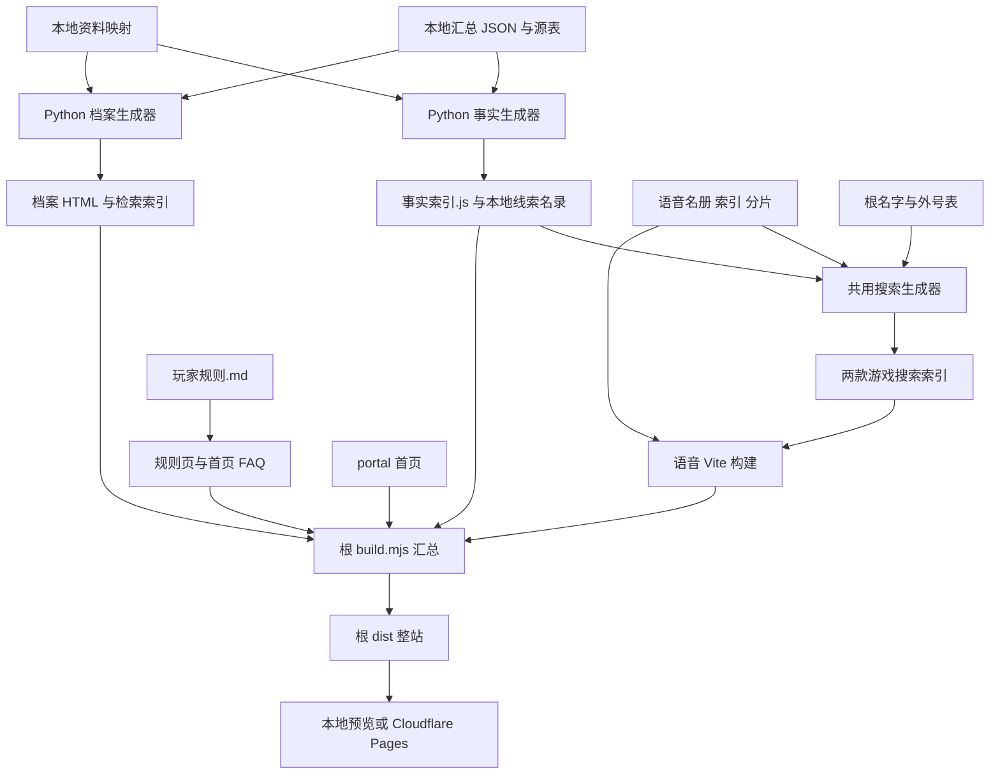

# 干员辨识训练：完整项目交接文档（新手版）

> 整理日期：2026-10-11（北京时间）。
> 适用对象：第一次接触本项目、甚至没有独立运行过网页项目的维护者。
> 核对基线：主仓库 `main`，提交 `deba261ece6898a90e6bca5ff7e480df595c34f1`，提交说明“新增三名干员档案与线索并同步时装和语音”。这是编写本文时的代码基线，不是未来永远不变的版本。
> 本文以仓库代码、本地资料和本次检查为依据。线上当前部署版本、账号权限和域名归属没有在本次交接中验证。

## 阅读导航

第一次接手，按以下顺序阅读：**第 1 节了解项目 → 第 2 节拿齐资料 → 第 4 节跑起来 → 第 5 节认清目录 → 第 9 节做验证**。准备改代码或更新数据时，再查对应维护步骤。

- [1. 项目是什么，当前做到哪里](#1-项目是什么当前做到哪里)
- [2. 接手前必须拿到哪些东西](#2-接手前必须拿到哪些东西)
- [3. 新手需要知道的几个概念](#3-新手需要知道的几个概念)
- [4. 从零启动：Windows 操作步骤](#4-从零启动windows-操作步骤)
- [5. 目录地图：应该改哪里](#5-目录地图应该改哪里)
- [6. 数据如何变成网站](#6-数据如何变成网站)
- [7. 四线索游戏：机制、数据和修改方法](#7-四线索游戏机制数据和修改方法)
- [8. 语音游戏：规则、数据和维护方法](#8-语音游戏规则数据和维护方法)
- [9. 验证和日常交付流程](#9-验证和日常交付流程)
- [10. 新增干员或时装的完整流程](#10-新增干员或时装的完整流程)
- [11. 发布、回滚和线上验收](#11-发布回滚和线上验收)
- [12. 常见问题排查](#12-常见问题排查)
- [13. 本地资产备份和换电脑](#13-本地资产备份和换电脑)
- [14. 已知限制、历史文档差异和后续工作](#14-已知限制历史文档差异和后续工作)
- [15. 接手验收清单和工作记录模板](#15-接手验收清单和工作记录模板)
- [16. 参考文档与交给下一位维护者的话](#16-参考文档与交给下一位维护者的话)

## 1. 项目是什么，当前做到哪里

### 1.1 项目目标

这是一个《明日方舟》干员辨识网站，仓库名称为 `arknights-operator-guess`，首页标题为“干员辨识训练”。网站包含两个游戏，以及给玩家核对线索用的干员档案。

| 内容 | 网站路径 | 做什么 | 实现方式 |
| --- | --- | --- | --- |
| 双游戏首页 | `/` | 进入两个游戏 | HTML、CSS |
| 语音猜干员 | `/voice/` | 听语音猜名字，可选输入或选择模式，可玩挑战 | Vue 3、Vite |
| 四线索猜干员 | `/clues/` | 每题最多公开四条机制线索，猜一个干员 | 原生 HTML、CSS、JavaScript |
| 干员档案 | `/干员档案展示版/首页.html` | 阅读技能、天赋、模组、台词、服装等资料 | Python 生成静态 HTML |

配置中的网站地址是 [coconutsmilk.top](https://coconutsmilk.top/)。仓库地址是 [CoConuts-Milk0325/arknights-operator-guess](https://github.com/CoConuts-Milk0325/arknights-operator-guess)。

本地主要工作目录为 `D:\代码\明日方舟`。换电脑时可以放在别的目录；本文的命令默认已经进入项目根目录，写死旧目录的历史工具需要另外调整。

两个游戏均在浏览器运行。当前正常游玩流程没有业务后端、数据库、登录系统或服务端排行榜；记录主要保存在当前浏览器。语音播放还依赖外部音频 CDN，头像也有外部请求。不要把“静态网站”理解为“所有内容都能完全离线”。

### 1.2 当前代码和数据状态

下表是 2026-10-11 对本地文件的交接基线，未来应以实际校验输出为准。

| 项目 | 当前值 | 从哪里确认 |
| --- | --- | --- |
| Git 主分支 | `main` | `git branch --show-current` |
| 最近代码提交 | `deba261`，2026-10-10 | `git log -1` |
| 两款游戏候选干员 | 各 434 名 | 事实索引、语音名册、数据校验 |
| 四线索事实 | 458 条 | `猜干员网页游戏/事实索引.js` |
| 四线索保底组合 | 434 组，每名候选都有一组 | 同上 `fallback` |
| 四线索语义版本 | `semantic-55` | 同上 `version` 的末尾 |
| 语音条目 | 32,238 条 | `npm.cmd run verify:data` |
| 语音缓存版本 | `20261010_2` | `voice-guess-arknights/src/dataVersion.js` |
| 正式干员档案页面 | 434 个 | `干员档案展示版/干员档案/` |
| 非干员档案页面 | 5 个 | `干员档案展示版/非干员档案/` |

完整事实版本还包含来源提交和汇总 JSON 内容哈希，不能只凭 `semantic-55` 判断两份数据是否完全相同。

### 1.3 最近完成的工作

1. 两个游戏已于 2026-09-30 合并到一个主仓库。`voice-guess-arknights/` 是普通源码目录，日常维护不需要 Git 子模块操作。
2. 四线索游戏已做过多轮机制语义修正，现有 `possibleMembers` 保守候选保护、唯一解校验、四线索保底组合，以及多个历史争议题回归。
3. 两款游戏共用名字、外号、全拼和拼音首字母检索数据，也支持 `?target=干员名` 定向调试。
4. 四线索游戏已有星级筛选、最近五题答案、点击历史答案回看当时结算、刷新恢复和存储受限时的内存兼容。
5. 语音游戏已有挑战避重、猜测上限联动、皮肤语音筛选、主备音源回退及故障重试。
6. 2026-10-10 新增克莱门莎、旅骨、德·托莱多，定向补充六款时装信息，并同步三名新干员的 216 条中日语音。

详细过程见 [最新更新记录](2026-10-10-干员与时装更新.md) 和 [修改记录](../修改记录.md)。旧记录中的数量、已撤销结论和旧路径只是当时的快照。

## 2. 接手前必须拿到哪些东西

### 2.1 先区分两种接手深度

**只修改界面、规则、外号或语音运行数据：**拿到 Git 仓库通常就可以构建和做网页测试。

**要修改四线索提取规则、更新完整档案、做资料回归或新增干员：**还必须拿到本地汇总资料、资料映射、整理脚本和更新批次证据。这些东西有一部分被 Git 忽略，`git clone` 不会下载它们。

这是本项目交接最容易遗漏的环节：**能打开网站，不等于具备完整的数据再生成能力。**

### 2.2 代码和权限清单

| 要接收的东西 | 为什么需要 | 本次状态 |
| --- | --- | --- |
| 主仓库读取权限 | 克隆、查看代码和历史 | 仓库地址已记录 |
| 主仓库写入权限 | 推送维护改动 | 接手时实际确认 |
| Cloudflare 账号或项目协作权限 | 查看构建日志、部署、回滚 | 本次未核实 |
| Cloudflare Pages 项目名称 | 找到正确发布项目 | 本次未核实，交接人应填写 |
| 域名注册商及 DNS 管理权限 | 域名故障、证书或解析维护 | 本次未核实 |
| Worker 管理权限 | 仅在继续维护音频代理时需要 | 本次未核实；当前前端默认直连 CDN |
| 原负责人联系方式、职责范围 | 判断谁能确认资料和上线 | 待交接双方填写 |
| 本地数据资产副本 | 继续生成线索和档案 | 原工作区存在，需实际移交 |

密码、登录验证码和 API 密钥通过账号协作或私密渠道交接，不写进本文、Git 提交或截图。

### 2.3 必须移交的本地资料

下面的路径相对于项目根目录。本次已确认这些本地资产存在并被忽略。

| 路径 | 用途 | 优先级 |
| --- | --- | --- |
| `干员文字资料/全体干员文字资料.json` | 线索和档案的主要输入，包含本地修订及 10 月定向补充 | 必须 |
| `干员文字资料/原始数据_中文服/` 整个目录 | 中文化源表、阵营表、版本说明、个人记录等 | 必须 |
| `干员文字资料/资料说明.md` | 来源、修订边界、重建注意事项 | 必须 |
| `工具脚本/` 中三个 `.py` 文件 | 字段中文化、原始资料整理、汇总资料生成 | 必须 |
| `干员档案展示版/资料映射/` 整个目录 | 物品、分支、范围、多语种台词、上线与获得方式 | 必须 |
| `干员档案展示版/准备展示映射.py` | 映射准备脚本；固定旧快照，不能直接用于当前全量恢复 | 必须保留，使用前审查 |
| `猜干员网页游戏/干员拼音映射.json` | Python 生成器的可选辅助输入 | 建议保留，复现原环境更稳妥 |
| `scratch/update-20261010/` 整个目录 | 新批次源表、合并脚本、更新前对照、验证日志 | 必须保留批次证据 |
| 历次机制审查记录和 `scratch/` 中相关验收文件 | 解释为什么做过某项特殊判定 | 建议保留 |
| `scratch/merge-backup-20260930-125943/` | 仓库合并前历史 bundle 和迁移快照 | 需要保留历史时移交 |

其中，线索生成器启动时就会读取 `干员档案展示版/资料映射/职业分支名称.json`，所以它也不是一个只拿 `全体干员文字资料.json` 就能完整运行的脚本。

当前汇总 JSON 为 **69,627,118 字节，约 66.4 MiB**。资料文件较大，确认复制完成后再校验，不要用聊天记录中的文字节选代替完整文件。

备份与恢复方法见第 13 节。接手时要实际检查文件，不能只收到一句“都在 GitHub 上”。

## 3. 新手需要知道的几个概念

| 名称 | 可以怎样理解 | 本项目里对应什么 |
| --- | --- | --- |
| 项目根目录 | 整个项目最外层文件夹 | 能看见根 `README.md`、`package.json` 和 `build.mjs` 的地方 |
| HTML | 网页结构和内容 | 首页、线索页面、档案页面 |
| CSS | 颜色、字体、间距、布局 | `style.css`、`游戏样式.css` 等 |
| JavaScript / `.mjs` | 浏览器逻辑或 Node 脚本；`.mjs` 明确使用模块语法 | 游戏逻辑、构建、共享搜索生成 |
| Vue | 用组件组织页面的前端框架 | 语音游戏的 `.vue` 文件 |
| Node.js | 在电脑上执行 JavaScript 的程序 | 构建、生成共享索引、网页测试 |
| npm | 安装依赖和执行 `package.json` 中命令的工具 | `npm.cmd run build` 等 |
| Python | 执行 `.py` 数据整理和页面生成脚本的程序 | 资料汇总、事实提取、档案生成 |
| Git | 记录源码历史、提交和同步代码的工具 | 主仓库 |
| 原始/汇总资料 | 整理前、整理后的上游内容 | `干员文字资料/` |
| 生成文件 | 脚本根据输入写出来的文件 | `事实索引.js`、档案 HTML、共享搜索索引 |
| `dist/` | 浏览器实际看到的构建结果 | 根 `dist/` 是整站；语音模块 `dist/` 是中间结果 |
| `node_modules/` | npm 安装的依赖文件夹 | 不提交，缺失时重新安装 |
| localStorage | 当前浏览器在本机保存的一小块数据 | 游戏记录、偏好、语音缓存 |
| 退出码 | 命令是否正常结束的结果 | PowerShell 中 `$LASTEXITCODE` 为 `0` 才表示该外部命令成功 |

**命令执行位置很重要。**根目录的 `npm.cmd run build` 构建整站；进入语音目录后执行同名命令只构建语音模块。遇到“不知道该在哪运行”，先执行 `Get-Location`。

本文统一用 `npm.cmd`，这样在 Windows PowerShell 中可以避开 `npm.ps1` 被执行策略阻止的问题。普通终端中能运行 `npm` 时，两者用途相同。

## 4. 从零启动：Windows 操作步骤

### 4.1 准备软件

需要：Git、Node.js **24**、浏览器、文本编辑器。要跑资料回归或生成档案，还需要 Python **3.10 或更新版本**。

Node 版本要求来自根 `package.json` 的 `engines`，本次使用 Node `v24.16.0`、npm `11.13.0`。本次实际执行 Python 回归使用 `3.12.14`。

安装后重新打开 PowerShell，逐条执行：

```powershell
git --version
node --version
npm.cmd --version
python --version
```

如果 `python` 不可用，检查 `py --version`，或使用实际安装的 Python 可执行文件完整路径。不能因为 Node 能运行就认定 Python 也已安装。

本次机器的 `python` 被解析到 WindowsApps 占位程序且无法启动，实际测试使用了 Codex 随附 Python：

```powershell
& 'C:\Users\古阳关\.cache\codex-runtimes\codex-primary-runtime\dependencies\python\python.exe' --version
```

这个路径只是在原机器上验证过的例子。换电脑后优先正常安装 Python，不要照抄他人的用户目录。

### 4.2 已经收到完整工作区

在 PowerShell 执行：

```powershell
Set-Location -LiteralPath 'D:\代码\明日方舟'
Get-Location
Get-ChildItem
git status --short --branch
```

确认列出的文件有 `build.mjs` 和根 `package.json`。如果有别人尚未提交的改动，先了解来源并保留；不要执行 `git reset --hard` 或 `git clean -fdx`。

### 4.3 只有仓库地址，需要克隆

先到你准备存放项目的父目录，再执行：

```powershell
git clone https://github.com/CoConuts-Milk0325/arknights-operator-guess.git
Set-Location -LiteralPath '.\arknights-operator-guess'
git status --short --branch
```

克隆后先按下面的步骤构建网站。要生成线索和档案，稍后按第 13 节将本地数据资产放回相同的相对路径。

### 4.4 构建完整网站

在根目录执行：

```powershell
npm.cmd run build
```

初次运行需要从 npm 获取依赖，必须能访问依赖源。成功时末尾会输出“**双游戏站点已生成至 dist/**”。立刻检查：

```powershell
$LASTEXITCODE
Test-Path -LiteralPath '.\dist\index.html'
Test-Path -LiteralPath '.\dist\voice\index.html'
Test-Path -LiteralPath '.\dist\clues\index.html'
```

退出码应为 `0`，三个路径检查均应为 `True`。不能只看见 `dist/` 就认为这次构建成功，因为它可能是旧产物。

根目录没有必须先安装的业务依赖；`build.mjs` 会自己在语音目录执行 `npm ci`。不要把“在根目录执行过 `npm ci`”当成语音依赖已经齐全。

### 4.5 启动整站预览

构建成功后执行：

```powershell
npm.cmd run preview
```

终端会持续占用，这是正常现象。打开终端打印的地址，默认通常为 `http://127.0.0.1:4173/`。如果端口已被占用，工具可能使用其他端口，以输出为准。

依次检查：

1. 首页能进入两个游戏。
2. `/clues/` 能开始一题，输入“能天使”，从建议里选中，然后提交。
3. `/voice/` 能载入干员和播放语音；音频失败时按第 12 节检查请求。
4. 四线索结算页的档案链接能打开对应 HTML。
5. 访问 `/干员档案展示版/首页.html` 可以搜索名字、技能、天赋。

按 `Ctrl+C` 结束预览服务。不要关掉终端后还认为服务一直运行。

也可以执行根 `npm.cmd run dev`，它等于“构建一次，再开始预览”。**这里的 `dev` 没有整站热更新。**

### 4.6 修改后怎样看到变化

整站预览读取根 `dist/`。修改源码后，一般执行以下步骤：

1. 在预览终端按 `Ctrl+C` 停止服务。
2. 回到根目录，重新执行 `npm.cmd run build`。
3. 构建成功后执行 `npm.cmd run preview`。
4. 刷新浏览器。

先停服务能减少 Windows 文件占用问题。构建每次执行 `npm ci`，会重建语音依赖目录；开着语音开发服务时可能占用 `esbuild.exe`。

只修改语音界面、需要热更新时：先完成一次整站构建，然后在根目录运行：

```powershell
npm.cmd run dev:voice
```

默认端口 5173。这个入口只开发语音模块，不提供整站首页、线索和完整档案路由；最终仍要回根目录构建与验收。当前 Vite 配置监听所有网卡，开发服务只在可信环境使用。

### 4.7 快速命令表

除明确写明外，以下命令都在根目录运行。

| 命令 | 用途 | 前提 |
| --- | --- | --- |
| `npm.cmd run build` | 构建整站 | Node 24、npm 依赖下载可用 |
| `npm.cmd run preview` | 预览根 `dist/` | 已成功构建 |
| `npm.cmd run dev` | 构建一次并预览 | 同构建 |
| `npm.cmd run dev:voice` | 语音热更新开发 | 已有语音依赖和共享索引 |
| `npm.cmd test` | 35 项语音 + 24 项线索网页回归 | 语音依赖齐全 |
| `npm.cmd run verify:data` | 校验语音运行数据 | 依赖齐全，无需外网 |
| `node 生成干员搜索索引.mjs` | 重新生成两款游戏的名字/外号/拼音索引 | 已安装语音依赖 |
| `node 猜干员网页游戏/生成规则页.mjs` | 更新规则页及线索首页 FAQ | 玩家规则格式符合生成器预期 |
| `python -X utf8 -B 猜干员网页游戏/生成游戏数据.py` | 从汇总资料生成事实索引 | 本地汇总 JSON、分支映射等齐全 |
| `python -X utf8 -B 干员档案展示版/生成展示档案.py` | 从资料生成档案页面 | 汇总、阵营表、五份映射齐全 |

## 5. 目录地图：应该改哪里

### 5.1 主要结构

```text
项目根目录/
├─ README.md                         快速运行说明
├─ package.json / package-lock.json   整站命令和根锁文件
├─ build.mjs                         统一构建入口
├─ .gitignore                        先全部忽略，再逐项放行
├─ 修改记录.md                       变更历史
├─ 明日方舟干员名字与外号对应表.md    共用外号唯一编辑入口
├─ 生成干员搜索索引.mjs               共用搜索生成器
├─ portal/                           双游戏首页及两张入口图
├─ 猜干员网页游戏/                    四线索界面、逻辑、事实生成器和回归
├─ voice-guess-arknights/             语音源码、数据、脚本、回归和模块文档
├─ 干员档案展示版/                    档案生成器和生成后的页面
├─ docs/                             项目交接和批次记录
├─ 干员文字资料/                     本地源资料：被忽略
├─ 工具脚本/                         本地中文化和汇总工具：被忽略
├─ scratch/                          备份、批次、验收证据：被忽略
└─ dist/                             整站构建结果：被忽略
```

### 5.2 根据任务找文件

| 想做的事 | 首先找这里 | 之后做什么 |
| --- | --- | --- |
| 改双游戏首页文字/结构 | `portal/index.html` | 整站构建 |
| 改双游戏首页外观 | `portal/style.css`、`portal/assets/` | 整站构建，桌面和手机检查 |
| 改四线索页面布局 | `猜干员网页游戏/首页.html`、`游戏样式.css` | 构建，运行线索网页回归 |
| 改四线索交互、评分、历史记录 | `猜干员网页游戏/游戏逻辑.js` | 网页回归、人工对局 |
| 修正“某干员是否满足某条线索” | `猜干员网页游戏/生成游戏数据.py` 和原资料 | 资料回归、重生成事实、唯一性检查 |
| 改玩家规则与 FAQ | `猜干员网页游戏/玩家规则.md` | 规则生成、构建、核对两处展示 |
| 增删外号 | 根 `明日方舟干员名字与外号对应表.md` | 共用搜索生成、两款游戏检索检查 |
| 改语音主界面和状态流 | `voice-guess-arknights/src/components/GameBoard.vue` | 语音回归及人工检查 |
| 改音频错误恢复 | `AudioPlayer.vue`、`src/logic/audioLoader.js` | 主源、备用源、晚到错误、重试回归 |
| 改语音抽题和选项 | `src/logic/gameEngine.js` | 筛选、候选耗尽、挑战避重回归 |
| 改挑战评级 | `src/logic/challenge.js` | 不同题数及混合模式回归 |
| 改语音显示台词或地址 | `public/data/voices/对应干员.json` | 版本更新、数据校验、试听 |
| 改语音星级/名册/时装字段 | `public/data/operators.json` | 稀有度口径检查、数据校验 |
| 改档案页面统一结构 | `干员档案展示版/生成展示档案.py` | 档案测试、重生成、抽查页面 |
| 改档案搜索 | `干员档案展示版/检索功能.js`、生成器的检索内容函数 | 档案搜索实际检查 |
| 改发布路径/合并规则 | 根 `build.mjs` | 整站构建和所有子路径检查 |

表中省略前缀的语音文件均位于 `voice-guess-arknights/` 下。

### 5.3 这些目录容易造成误会

- `voice-guess-arknights/`：**当前参与主仓库构建的语音源码**。
- `.voice-source/`：原机器上的本地历史副本，本次检查发现其内部有自己的 `.git`；不参与 `build.mjs`，也不是当前维护入口。
- `D:\代码\配音猜干员\voice-guess`：旧独立工作区，10 月批次曾从中同步用户已经更新的三个分片。此历史来源不改变现在以主仓库为维护入口的规则。
- `voice-guess-arknights/dist/`：只有语音模块的构建结果，不是整站输出。
- 根 `dist/`：整站最终输出。直接修改它，下次构建会丢失。
- `首页预览/`：本地截图及拍摄脚本。
- `promo-*`：本地宣传视频、动画或素材工作目录，不参与网站构建。继续宣传内容工作时另行核对这些项目，不能用本文网站验收代替视频验收。
- `.workbuddy/`、缓存、`__pycache__/`：本地工具状态或缓存，不是正常发布入口。

### 5.4 Git 忽略规则特别提醒

根 `.gitignore` 第一行是 `*`，表示先忽略所有东西，再用 `!` 放行维护文件。因此：**新建文件不一定会出现在 `git status`。**

检查方法：

```powershell
git status --short
git check-ignore -v -- '你新建的文件路径'
git ls-files -- '你以为已经提交的文件路径'
```

`docs/` 已整体放行，交接与变更说明适合放这里。线索、档案等目录按具体文件放行，新增脚本需要同时评估并更新忽略规则。不要为了省事把本地全部资料、依赖、缓存和私密配置一起强制添加。

## 6. 数据如何变成网站

### 6.1 整体关系



Python 生成与网站构建是两层工作。普通 `npm.cmd run build` 使用已经生成并提交的事实索引和档案页面，**不会自动运行两个 Python 生成器**。

### 6.2 根构建脚本实际执行顺序

1. 检查语音目录 `package.json` 存在。
2. 在语音目录执行 `npm ci`，按锁文件重装依赖。
3. 从两款游戏名册及根外号表，生成两份共用搜索数据。
4. 使用 `/voice/` 作为资源基路径，执行语音 Vite 构建。
5. 清空并重建根 `dist/`。
6. 复制 `portal` 首页、CSS、入口图片。
7. 从 `玩家规则.md` 生成完整规则页及线索首页 FAQ。
8. 将线索页面和运行文件复制到 `dist/clues/`，注入 `<base href="/clues/">`。
9. 将语音模块构建结果复制到 `dist/voice/`，注入 `<base href="/voice/">`。
10. 将档案首页、样式、检索文件及两个档案目录复制到整站输出。
11. 生成旧 `/首页.html` 到 `/clues/` 的兼容跳转。

构建会写回部分源码目录中的生成文件。如果规则、外号、名册变化，`git status` 可能出现生成差异，应检查后一并提交。

规则生成在语音构建之后、整站输出处理中执行。后半程失败时，根 `dist/` 可能处于不完整状态；此时先修正原因，再完整重建，不要直接发布。

### 6.3 网站运行不依赖和再生成依赖的区别

| 文件组 | 网站构建需要 | Python 再生成需要 | 随 Git 获取 |
| --- | --- | --- | --- |
| 已发布事实索引和档案 HTML | 是 | 作为比较基线 | 是 |
| 语音名册、语言索引、434 个分片 | 是 | 语音更新直接使用 | 是 |
| 外号表和共享搜索生成器 | 是 | 是 | 是 |
| 汇总资料及中文源表 | 否 | 是 | 否 |
| 档案资料映射 | 否 | 是；线索也读取分支名称映射 | 否 |
| 资料整理和映射准备工具 | 否 | 重建来源时需要 | 部分否 |
| Python 回归脚本 | 否 | 验证资料修改时需要 | 是，但其输入不全在 Git |

## 7. 四线索游戏：机制、数据和修改方法

### 7.1 玩家看到的流程

每题选择一个目标，组合四条线索，开始只公开一条。前面三个阶段猜错或主动查看会公开下一条；四条都公开后可以继续猜，不会生成第五条。猜中或放弃才结算。

作答必须从搜索建议中选中候选。只输入“正确的文字”但没有选中候选，无法提交，这是当前交互设计。

猜中时公开 1、2、3、4 条分别得 4、3、2、1 分，放弃得 0 分。当前代码确实保存并展示已完成局数和总分。

星级筛选限定抽题与作答候选，至少保留一档。改选排除了正在进行的目标时，会重新出题并清空本局进度，旧题不计分。即使只勾一个星级，四条线索的唯一性仍按完整候选库判断。

最近五题保存结算快照，包括目标、线索、证据和得分。打开历史不应重抽当前题、不应重复计分，也不应丢失正在输入的内容。旧版本只有名字的记录不能伪造历史线索。

### 7.2 事实索引结构

生成文件通过 `window.GUESS_DATA` 给浏览器提供数据。

| 字段 | 含义 | 维护注意 |
| --- | --- | --- |
| `version` | 来源、内容哈希、语义版本 | 更新规则时按实际需要升级语义后缀 |
| `operators` | 候选列表，含 ID、名字、职业、1～6 星、档案链接 | 数组下标是本份索引的内部编号 |
| `facts` | 所有事实 | 事实有稳定字符串 ID、题面、类别、主题等 |
| `facts[].members` | 已确认满足该事实的干员下标 | 用于目标事实索引与展示 |
| `facts[].possibleMembers` | 不能排除的候选，含确认成员和待核对项 | 唯一性求交使用它；没有该字段才回退 `members` |
| `facts[].evidence` | 每位成员的来源和依据 | 避免只给结论、不提供可核对文本 |
| `facts[].topic` | 主题 | 同一道题不重复主题 |
| `facts[].family` | 机制大类 | 控制题目组合和展示 |
| `facts[].implies` | 本事实已包含的较弱事实 ID | 同题不能把强弱两条一起使用 |
| `byOperator` | 每位干员对应的事实下标列表 | 应与 `members` 的反向索引一致 |
| `fallback` | 为每位干员准备的四条唯一解组合 | 随候选和事实变化重新求解 |

**不能跨版本保存干员数组下标当永久身份。**新增干员会改变排序，应使用干员 ID 或在历史结算中保存完整快照。

### 7.3 为什么不能删掉“可能成员”来凑唯一解

如果某条线索确认 A 满足，但 B 的召唤物能力尚未核实，那么 B 可能满足。若计算四条线索时直接删掉 B，就会把一道尚未证明唯一的题误当唯一题。

因此 `possibleMembers` 是保守保护。遇到双解，应纠正事实或换组合；不能通过排除真实能力、缩小未核实候选或只在选中星级里求交来强行保证出题。

生成器如果无法为所有候选找到四线索组合，会抛错并拒绝发布不完整答案池。这个保护不能随意关掉。

### 7.4 出题组合约束

生成器与前端都检查唯一性。前端随机尝试组合，必要时使用保底组合。主要约束为：

- 四条事实互不相同，且目标确认满足每条。
- 按完整候选的 `possibleMembers` 求交，只剩目标一人。
- 不重复同一个 `topic`。
- 不同时出现 `implies` 已包含的强弱事实。
- 统计与精确数值类合计最多一条。
- 复合类最多一条。
- 随机组合还有类别多样性与近期使用惩罚；近期避重不是永不重复承诺。

### 7.5 判题口径必须保留的边界

优先阅读完整 [玩家规则](../猜干员网页游戏/玩家规则.md)，再查看实际实现。以下是容易回归的重点：

1. 默认满练、零潜；明确写“满潜满练”的费用线索按题面采用满潜。特限证章不参与能力盘点。
2. “可以”“有技能”允许合法条件或概率触发。不能只看常态就排除条件连击。
3. “没有”“只能”“仅一种”需要排查全部合法能力，文本没提取到不等于能力不存在。
4. “同一技能兼具 A 和 B”要求同一个技能和一套合法配置，不拼接互斥技能或模组；保留的普攻及直接触发天赋可以按已核定联动计入。
5. 本体、召唤物、装置、替身以及其他友方必须分清。召唤物伤害可证明提供的战斗能力，其回血不能冒充本体自身回血。
6. 普通攻击主动对空、技能/特殊伤害对空、完全无对空能力分别判断，前后两类不是简单互补。
7. 真群攻要有对空间范围内所有敌人的实际伤害，不能把固定 N 个目标、只加减属性、只施加状态当真群攻。
8. 连续 N 次攻击和同时攻击 N 个目标不是一回事。
9. 敌方附着状态或持续区域反复结算才符合持续伤害口径；连续斩击、延时一次爆炸不直接等同持续伤害。
10. 减速数值削弱和“停顿”状态区分；敌方神经损伤爆发产生麻痹，不能套用我方晕眩。
11. 直接治疗他人、自身回血、缓回、治疗限制及治疗量修饰分别判定；“无法被治疗”本身不是治疗能力。
12. 本体范围扩大/缩小分别按真超集/真子集及明确证据核对，范围形状变化和召唤物范围不能混入。
13. 随机金额或技能结束时一次结算的回费可属于直接回费；按攻击或周期累计的回费不能据此入选。
14. Fever 是共享机制，不能称为携带技能；技能中写明的 Fever 条件效果仍可成立。
15. 异常状态、伤害、支援等的否定统计必须保留未知项保护，不能用一个关键词匹配替代完整核对。

### 7.6 修正一条错误事实的步骤

1. 记录干员、事实 ID、错误题面、当前结算证据及页面版本；如果是双解，记录完整四条 ID。
2. 阅读该干员汇总资料、档案技能最高等级、相关天赋和常规模组。必要时查上游固定版本与机制说明，保存来源。
3. 检查 `生成游戏数据.py` 中 `make_profile`、`facts_for`、相关机制函数及 `AUDITED`、`REVIEWED_EXCLUSIONS` 等审定表，判断错误来自资料、通用规则还是人工审定。
4. 在 `test_audit_corrections.py` 补有实际意义的回归：错误对象、正常对象、反例、主语/条件边界；先确认旧实现能复现问题。
5. 修改对应规则或证据，不直接手改巨大 `事实索引.js` 凑结果。
6. 跑 Python 回归；然后重生成事实索引和四份本地线索目录。
7. 核对成员变动、待核对候选、反向索引、包含关系、所有保底题和档案链接。
8. 更新玩家规则中确实受影响的口径，生成规则页，整站构建和网页回归。
9. 用定向目标实际走一局，在结算页查看每条证据；记录修正原因、影响边界和验收结果。

命令：

```powershell
python -X utf8 -B -m unittest discover -s '猜干员网页游戏' -p 'test_*.py'
python -X utf8 -B '猜干员网页游戏/生成游戏数据.py'
npm.cmd run build
npm.cmd test
npm.cmd run verify:data
git diff --check
```

逐条执行，失败就停下调查。完整 Python 回归本次约 89 秒；机器和改动不同，时间会变化。

`npm.cmd run verify:data` 校验的是**语音运行数据**，不会替代线索事实真实性、全量保底题或原始资料回归。

### 7.7 修改规则和常见疑问

唯一编辑入口为 `玩家规则.md`。完整规则页和线索首页“常见疑问”由 `生成规则页.mjs` 生成；FAQ 来源是该 Markdown 的“常见疑问速查”章节。

修改后执行 `node 猜干员网页游戏/生成规则页.mjs` 或整站构建，然后检查 `规则说明.html` 和线索首页都同步。不要只手改生成后的 HTML，否则下一次生成会覆盖。

规则文字本身存在的历史矛盾见第 14 节。维护时根据已经确认的产品行为修正文案；不要因为文案有一句旧描述，就擅自反向删除现有功能。

### 7.8 修改外号或拼音

根外号表是两列表格：名字、外号。多个外号用 `、` 分隔；无外号可填 `—`。完整本名优先，共用外号允许匹配多个候选。

```powershell
node '生成干员搜索索引.mjs'
npm.cmd test
npm.cmd run build
```

会生成 `猜干员网页游戏/干员搜索索引.js` 和 `voice-guess-arknights/src/operatorSearchIndex.json` 两份数据。两份一起检查并提交。

检查本名、外号、全拼、首字母、共用外号和星级筛选。例如已恢复的“火陈”应能找到赤刃明霄陈。历史记录中要求它失效的描述已被后续用户要求取代。

共享生成器有重岳、仇白的读音覆盖；Python 生成器另有自己的拼音辅助。读音问题先明确是网页共用搜索还是其他本地工具，不要只改错的一份映射。

## 8. 语音游戏：规则、数据和维护方法

### 8.1 关键源码

以下路径相对于 `voice-guess-arknights/`。

| 文件 | 主要职责 |
| --- | --- |
| `src/components/GameBoard.vue` | 设置、加载、题目请求、猜测、挑战和预加载 |
| `src/components/AudioPlayer.vue` | 播放、进度、主备源回退、重试和错误提示 |
| `src/logic/audioLoader.js` | 音频加载和预加载 |
| `src/logic/gameEngine.js` | 可播放片段筛选、抽题、选项、评分和头像 |
| `src/logic/challenge.js` | 挑战记录、满分、评级和总结 |
| `src/logic/operatorSearch.js` | 名册加载和输入检索 |
| `src/cache.js` | 数据缓存、过期、旧版本清理和存储容错 |
| `src/dataVersion.js` | 唯一数据版本号 |
| `src/config.js` | 音源前缀解析、主源和备用源 URL |
| `src/utils/constants.js` | 26 类基础语音、评级阈值、CDN 基址等 |
| `scripts/verify-updates.mjs` | 默认本地数据校验与可选联网抽查 |
| `test/*.test.mjs` | 语音、检索、缓存、播放器、服务和数据维护回归 |

更细节的说明见 [语音模块交接文档](../voice-guess-arknights/docs/HANDOVER.md)。它是模块补充，整站维护入口以本文和根 README 为准。

### 8.2 当前玩法约束

- 普通模式与挑战模式都按星级、语言和语音类型筛选；无有效片段的干员跳过。
- 输入模式和选择模式均支持。选择项数量随每题最大猜测次数，默认 10，不是固定四选一。
- 默认每条语音可猜 3 次，每题可猜 10 次。片段数量不是固定三条。
- 挑战题数 3～20，默认 10，同轮干员不重复；开始前检查当前筛选是否有足够可播放候选。
- 输入模式第 1、2、3 条语音猜中为 150、130、110 分；第 4 条及以后为 100 分。选择模式猜中 100 分，失败 0 分。
- 评级按各题结算模式所对应满分之和计算比例，再折算到 3000 分阈值；连胜只统计，没有额外加分。
- 普通模式确认设置会重抽；挑战中确认设置保留当前题，新条件用于后续题。缩小筛选可能导致剩余候选不足。
- 挑战中降低猜测上限，已经达到新上限时只结算一次；旧请求或旧播放器事件不得覆盖或跳过新题。

### 8.3 三组运行数据

1. `public/data/operators.json`：干员元数据数组。
2. `public/data/voice-index.json`：名字到语言数组的索引，用于维护与校验，前端当前不请求它。
3. `public/data/voices/{干员名}.json`：该干员的语言、类别和音频条目。

**语音元数据的 `稀有度` 为 `'0'`～`'5'`，实际星级 = 数值 + 1。**六星应写 `'5'`。四线索及中文化汇总资料的星级采用 1～6，不可混用。

分片结构示意如下，地址为示意占位，不能直接复制进真实数据：

```json
{
  "中文": {
    "登录": [
      {
        "url": "bwiki:实际相对媒体路径.mp3",
        "text": "该句中文显示台词",
        "alt": "prts:实际相对备用路径.mp3"
      }
    ]
  },
  "日文": {
    "登录": [
      {
        "url": "bwiki:实际日文媒体路径.mp3",
        "text": "该句中文译文",
        "alt": "prts:实际日文备用路径.mp3"
      }
    ]
  }
}
```

真实游戏沿用“中文”“日文”等语言键。档案映射中的“日语”等字段是另一套资料格式，不要直接拿来替换运行分片。

还有一个名称格式差异：语音名册和文件名使用 `阿米娅(医疗)`、`阿米娅(近卫)` 的半角括号，线索和档案使用 `阿米娅（医疗）`、`阿米娅（近卫）` 的全角括号。共享检索做 NFKC 规范化后可对应起来。跨模块核对名单时要考虑此差异；各模块内文件名、名册、索引仍须匹配，不能为了表面统一直接改一侧名字而不迁移相关文件和链接。

`text` 是显示用文本，日文语音可用中文译文；它不证明音频说的是中文，也不保证是日文转写。旧字符串条目兼容保留，但新维护尽量提供可核对对象数据。

### 8.4 主源、备用源和代理

当前代码 `AUDIO_BASES` 有两个源：

- `bwiki:` → `https://patchwiki.biligame.com/images/arknights/`。
- `prts:` 或无前缀 → `https://torappu.prts.wiki/assets/audio/`。

PRTS 的 `.wav` 请求会转换为同名 `.mp3`。`alt` 是备用源，播放器在主源网络或解码失败时回退一次；备用也失败时显示重试/跳过处理。

不能凭 URL 返回 200 就确认录音与台词匹配；可能是错误语言、错人、错槽位，仍要听样本并核对文本。

本地 `server.js` 只代理 `/audio/` 的 PRTS 请求，并提供语音模块 `dist/`；当前前端默认直连 CDN。**单独启动 server.js 不会让前端自动走代理。**本地代理设置的完整说明见模块交接文档。

Cloudflare Worker 配置在 `wrangler.toml`、入口 `cf-worker.js`，服务名为 `voice-guess-arknights`。要切换 PRTS 代理，当前实际应修改 `src/utils/constants.js` 的 **`AUDIO_BASES.prts`**，填真实 Worker 地址加 `/audio/`，再构建。`bwiki:` 主源不随这一修改自动代理。

Worker 部署、域名、上游与缓存必须分别验证。当前没有已确认的自定义 Worker 路由，不能把 Pages 网站域名当成 Worker 地址。

### 8.5 语音数据更新流程

1. 查明目标的正式中文名、ID、实际星级、语言、语音类型、台词和真实地址。
2. 更新元数据、语言索引、对应分片；三处名字严格一致，不用昵称代替正式文件名。
3. 修改 `src/dataVersion.js`，使用新的唯一版本，例如维护日期加批次序号；不要复用旧号。
4. 如果工作区存在可选 `voice-texts.json` 总表，运行同步脚本刷新；不存在时不必为了构建创建它。
5. 执行网页回归、数据校验、整站构建。
6. 在浏览器确认新分片请求带新版本，试听每个新增语言的样本、验证备用源。
7. 检查 Git 差异，确保没有误改旧干员的大量音源或其他批次资料。

命令：

```powershell
node 'voice-guess-arknights/scripts/sync-voice-texts.mjs'
npm.cmd test
npm.cmd run verify:data
npm.cmd run build
```

`DATA_VERSION` 同时影响元数据请求、分片请求和 localStorage 前缀 `voice-guess-v2-数据版本-`。当前缓存 TTL 为 24 小时。只强制刷新 HTTP 缓存，不一定解决旧 localStorage 的命中问题。

### 8.6 维护脚本不能不看就运行

| 脚本 | 用途 | 使用前确认 |
| --- | --- | --- |
| `update-p3r-operators.mjs` | 既有联动批次导入模板 | 写死目标和语言假设，不是任意新干员的通用爬虫 |
| `generate-dialect.mjs` | 已注册方言条目生成 | 注册名单、句序、实际录音存在性 |
| `fix-jp-voice-texts.mjs` | 把同序号中文文本回填日文显示文字 | 两组条目顺序对应；不会获取日文原文 |
| `sync-voice-texts.mjs` | 从分片刷新已存在的可选总表 | 总表位置在模块上一级，换目录后要核对 |
| `fetch-bwiki-voices.mjs` | 抓取 BWiki 页面并缓存 | 外网、抓取范围、缓存及频率 |
| `apply-bwiki-voices.mjs` | 对齐和替换 BWiki 音源 | 默认 dry-run，带 `--write` 才写入；审查 HOLDOUT 与对齐证据 |
| `verify-updates.mjs --online` | 名册末尾四位的头像与各语言首条音频 HEAD 抽查 | 不是全库审核，也不保证是最近发布日期排序 |
| `audit-*`、`sample-language.mjs`、`asr-*` 等 | 本地音频和转写审计 | 部分写死旧工作区路径，有些需要付费外部 API |

脚本清单不代表每个脚本都已适配新电脑或已在此次交接执行。运行前读顶部的路径、参数和写入位置。

可选 ASR 审计脚本读取当前工作目录下 `.env.local` 中的 `SILICONFLOW_API_KEY`，还可能依赖旧工作区音频名册。正常网站构建与游玩不需要该密钥。不要把缺少它当成项目基础启动失败，也不要把配置值写入交接文档。

## 9. 验证和日常交付流程

### 9.1 本次交接实际验证

本次在当前本地代码上重新执行，区别于历史记录中的验收。

| 检查 | 本次结果 | 范围和限制 |
| --- | --- | --- |
| 根 `npm.cmd test` | 35 项语音 + 24 项线索，59 项通过 | 首次沙箱内回环连接 `EACCES`；在允许本机连接的环境重跑通过 |
| 根 `npm.cmd run verify:data` | 434 名干员、32,238 条语音校验通过 | 默认离线，检查名册/索引/分片/稀有度/搜索及存在的总表 |
| 线索 Python 回归 | 119 项通过，89.126 秒 | 使用 Python 3.12.14；需要本地资料 |
| 档案 Python 回归 | 2 项通过 | 默认沙箱临时目录受限，改用工作区内临时目录后通过 |
| 整站构建 | `npm.cmd run build` 通过，生成根 `dist/` | 沙箱内 npm 安装报错；在允许依赖安装的环境重跑通过，锁文件未变 |
| 数据合同复核 | 434 组保底题唯一，正反索引和档案链接一致 | 按 `possibleMembers` 求交；四条不重复主题、不含强弱冗余，统计/数值与复合类数量符合限制 |
| Git 文档检查 | 39 个本地链接/章节导航、28 段 PowerShell 语法及 `git diff --check` 通过 | 新文档未被忽略，备份和发布示例没有在本次执行；外部网址未做在线可用性检查 |
| 线上版本、浏览器对局、全库音频试听 | 本次未执行 | 不把历史成功记录写成本次线上验收 |

网页与资料回归合计 **180 项**。其中不少测试针对机制函数和已知问题，不能理解为“32,238 条录音全部试听过”或“458 条机制人工逐条审核过”。

本次构建实际提示 **7 项依赖漏洞（1 项中等、6 项高）**，以及 Windows `shell: true` 调用的 Node `DEP0190` 弃用警告；与历史记录中的 4 项数量不同。本次没有修改依赖版本或执行 `npm audit fix`。需要维护者单独评估升级范围和兼容性，不能用一次构建成功代替依赖问题处理。

### 9.2 基础验证命令

界面、外号、规则或语音运行数据修改，至少：

```powershell
npm.cmd run build
npm.cmd test
npm.cmd run verify:data
git diff --check
git status --short
git diff --stat
```

执行构建前停止本项目的开发或预览服务，避免安装依赖时被文件占用。构建成功不等于测试通过，测试通过也不代表已经发布。

修改线索生成器或汇总资料，再增加：

```powershell
python -X utf8 -B -m unittest discover -s '猜干员网页游戏' -p 'test_*.py'
```

修改档案生成器、材料展示或映射，再增加：

```powershell
python -X utf8 -B -m unittest discover -s '干员档案展示版' -p 'test_*.py'
```

这些 Python 命令在只有 Git 的新副本里可能因缺少本地输入失败。补齐资料后再验证，不要把依赖缺失改成“跳过所有回归”。

### 9.3 只有某一个小修改时

| 改动范围 | 应关注的验证 |
| --- | --- |
| 单纯文字/CSS | 构建、实际页面、桌面及手机布局；不用新写一堆只复述样式的测试 |
| 外号/拼音 | 共用检索回归、两款游戏搜索、共用歧义、删改边界 |
| 历史/筛选/评分交互 | 线索网页回归、刷新、禁用存储、未完成输入、清除记录 |
| 音频恢复/挑战状态 | 语音回归、主备失败、重试、旧事件、猜测上限、候选耗尽 |
| 事实成员或提取规则 | 源资料回归、成员差异、保守候选、唯一性、证据、相关争议题 |
| 新干员/批次 | 所有适用回归、三套名册一致、链接、音频语言和定向变更边界 |

### 9.4 手工验收步骤

1. 桌面至少检查约 1366×768，手机至少检查约 390×844；确认无横向溢出，主要按钮可操作。
2. 首页两个入口、线索规则页、档案链接、语音和线索子路径直接刷新均正常。
3. 四线索：开始、选中候选、猜错、下一线索、放弃、下一题、星级改选。
4. 四线索：完成两题，打开旧历史，返回当前题；确认进度和输入保留，分数不重复增加。
5. 四线索：刷新、清除记录，确认历史清空但当前题和星级行为符合规则。
6. 语音：输入与选择模式、语种/类别筛选、挑战启动、候选不足提示、评级。
7. 语音：网络故障时备用源、终止进度、最后一条重试；不要只测“网络一直正常”的路径。
8. 打开浏览器开发者工具的 Console/Network，确认没有新异常、资源 404 或路径跳回错误目录。

定向调试示例：

```text
http://127.0.0.1:4173/clues/?target=能天使
http://127.0.0.1:4173/voice/?target=能天使
http://127.0.0.1:4173/clues/?target=克莱门莎
```

以实际端口为准。定向目标仍遵守星级筛选；语音挑战中也不能绕过已用干员排除。想恢复正常随机抽题，删除地址中的 `target` 参数。

### 9.5 提交前检查

```powershell
git status --short --branch
git diff --stat
git diff --check
git diff -- '你修改的关键文件'
```

确认生成文件一起更新，没有混入本地私密配置、缓存、`node_modules/`、`dist/` 或整个原始资料目录。

维护者日常可以为任务创建 `codex/具体任务名` 分支，例如 `codex/update-operators-20261011`。本文本身没有创建新分支、提交或推送；具体发布动作要按实际协作约定执行。

## 10. 新增干员或时装的完整流程

### 10.1 为什么不是“往一个 JSON 里加名字”

同一个新增干员至少影响：汇总资料、档案页面、事实候选与保底组合、共享搜索、语音元数据、语言索引、分片、缓存版本和规则中的数量说明。

只改其中一个位置，常见结果是：能搜索但不能抽题、语音名册有名字却没有分片、线索结算找不到档案、旧题新增第二解、浏览器继续使用旧数据。

### 10.2 当前资料版本的保护边界

基础汇总资料来自固定提交 `f6a8967a14aad645b025afdada5a88e1aaeb2762`；2026-10-10 的三名新干员和指定时装来自 `e4888c5b4d9b57aa3bfd4d109ae70f74cf3b7842`，按目标定向合并。

**原始中文表没有整体升级到 10 月新版本。**当前汇总 JSON 含本地修订及定向补充。直接运行旧原始表的汇总重建，会覆盖本地修订并丢失新批次。

需要完整换版时，先在旁路目录生成新版，再逐项迁移本地修订并核对差异，不能直接覆盖当前主文件。

### 10.3 更新一个新批次的建议顺序

1. **备份。**记录当前提交、汇总资料哈希、事实版本、语音版本，复制更新前汇总和事实索引。
2. **固定来源。**保存上游提交 SHA、源表和实际读取日期；建立新的 `scratch/update-日期/`，不要覆盖旧批次证据。
3. **明确范围。**列出新增干员 ID、名字、星级、职业，列出时装与是否有专属语音。区分只补档案、只补时装和新增录音。
4. **旁路整理。**用新批次源表生成临时资料，不覆盖当前汇总。既有汇总工具支持 `--源数据目录`、`--输出文件`；原始整理脚本本身会写固定本地目录，使用前先读清楚。
5. **定向合并。**只将本批需要的干员和服装合入当前汇总，保留非目标资料与历史修订，更新来源说明与统计。
6. **补映射。**更新新增分支、攻击范围、物品、多语种台词、上线/获得方式。检查线索用完整范围表与档案用坐标映射两种格式，不能互换。
7. **生成档案。**运行 `生成展示档案.py`；确认档案的技能、材料、语音、服装、星级、范围、上线时间及档案搜索。
8. **生成事实。**运行 `生成游戏数据.py`，检查每名新增候选都有保底题，旧题交集也重新核对。
9. **更新语音。**维护名册、索引和分片，确认实际语言与槽位，保留主备音源；不因档案有生日台词就自动扩大游戏语音类别。
10. **更新版本和说明。**语音 `DATA_VERSION` 必须新号；机制变化更新语义版本；规则数量、来源与变更记录同步。
11. **运行全套适用检查。**Python 回归、网页回归、语音校验、全量唯一性、链接、变更边界、整站构建和浏览器样本。
12. **交付证据。**保存每种检查的范围、命令、结果和未验证事项，再提交当前主仓库。

### 10.4 旁路生成汇总资料示例

以下是命令格式示例，运行前要先准备对应目录和版本相符的中文源表：

```powershell
python -X utf8 -B '工具脚本/生成干员文字资料.py' `
  --源数据目录 '.\scratch\你的新批次\source' `
  --输出文件 '.\scratch\你的新批次\upstream-profiles.json'
```

PowerShell 行末反引号表示继续下一行，其后不要放空格。也可以写成一行。

此命令只示范汇总工具支持的旁路输出，不是“自动合入当前项目”的命令。当前维护资料里的本地修订还需要专门合并。

### 10.5 时装维护注意

2026-10-10 接到六个时装链接：千尺俯瞰、慵怠哼唱、照寰瀛、真我自扼、万籁俱寂、来日欢歌。照寰瀛档案原已收录，所以档案新增五款、语音元数据同步六款。

这六款来源 `voiceType` 为 `NONE`，没有独立时装录音。**新增时装资料不等于新增皮肤语音分片。**未来批次也先确认来源，再决定是否增录音。

### 10.6 如何保证没有意外改旧数据

至少比较更新前后：

- 旧干员是否仍存在，ID/名称/星级是否意外改变。
- 非目标干员汇总内容是否完全一致；只有指定服装的干员允许相应字段改变。
- 非干员档案是否意外变化。
- 旧确认机制成员的改变是否都有理由；候选统计类随名单变化是另一种合法变化，要单独解释。
- 语音旧分片是否被全量重写地址、语言或顺序。
- 全量保底题是否仍唯一，已知争议题是否还被拒绝作为唯一题。
- 两份共享搜索索引、规则页及发布产物是否与当前输入一致。

`scratch/update-20261010/verify-local.mjs`、`verify-build.mjs` 等是**本批次**示范，包含固定人数、目标和对照路径，未来使用必须改成新批次合同，不能照跑后拿旧结果证明新批次。

## 11. 发布、回滚和线上验收

### 11.1 当前整站配置

仓库文档规定的 Cloudflare Pages 参数为：

| 配置 | 值 |
| --- | --- |
| 生产分支 | `main` |
| 构建命令 | `node build.mjs` |
| 构建输出目录 | 根 `dist` |
| 构建根目录 | 仓库根目录，不是语音子目录 |
| Node 版本 | 24，与项目要求一致 |
| 自定义网站域名 | 文档配置为 `coconutsmilk.top`，后台实际状态需确认 |

实际 Pages 项目名称、Git 集成、构建环境变量和自动部署是否开启，需要登录后台确认；本地远端跟踪分支的状态不能证明线上已经更新。

### 11.2 标准发布顺序

1. 本地生成、构建、测试、数据校验和浏览器检查完成。
2. 审查差异和变更说明，确认提交范围。
3. 按团队协作方式提交并合入发布分支；若开启 Pages Git 自动部署，推送 `main` 可能触发上线，提前知晓这一点。
4. 在 Pages 后台核对构建对应的提交 SHA、构建日志、输出目录、部署结果和预览 URL。
5. 打开新部署，检查首页、两游戏、规则、档案，以及子路径直接刷新。
6. 检查新语音数据版本和新事实索引实际已加载，不能只看首页标题。
7. 记录发布提交、部署时间、部署地址、结果及回滚版本。

**推送成功、构建成功、部署成功、浏览器载入新数据，是四件不同的事。**

### 11.3 遗留部署文件怎么处理

`voice-guess-arknights/.github/workflows/deploy.yml` 和 `voice-guess-arknights/CNAME` 是旧独立语音项目的配置。

GitHub Actions 识别的是主仓库根 `.github/workflows/`。本次检查主仓库没有对应根工作流，嵌套的旧工作流不会为整个主仓库自动执行。不能因此认为每次整站发布前都自动跑了 `npm test`。

两款游戏现在由主仓库整站发布。不要为修复一个页面去恢复旧子模块、部署旧语音仓库或把语音 `dist/` 上传覆盖整站。

### 11.4 回滚

出现线上故障时，先记住坏版本提交和错误范围，再选择实际可用的方式：

- Pages 后台如果允许回滚到此前成功部署，可先恢复已知正常的整站版本。
- 源码层面用 `git revert` 撤销明确问题提交，再重新验证与发布；共享分支通常不要用强制推送改写历史。
- 资料回滚还需恢复对应本地汇总/映射，否则下一次重生成会再次写出错误数据。
- 语音数据回退后也使用新的唯一 `DATA_VERSION`，避免浏览器误命中某个旧版本缓存。

不要用 `git clean -fdx` 做“恢复环境”：它可能删除被忽略的汇总资料、映射和批次备份。源代码能从 Git 恢复，不代表本地数据也能恢复。

## 12. 常见问题排查

### 12.1 命令和环境问题

| 现象 | 先检查 | 建议处理 |
| --- | --- | --- |
| 找不到 `npm`/`node` | 版本命令、是否重开终端 | 安装正确 Node 24，确认 PATH |
| PowerShell 提示禁止运行 `npm.ps1` | 是执行策略报错还是依赖问题 | 改用 `npm.cmd`，通常不必改全局执行策略 |
| `python.exe` 指向 WindowsApps 却运行不了 | `Get-Command python`、`py --version` | 使用真实 Python 安装或其完整路径 |
| `Cannot find module pinyin-pro` | 语音依赖目录是否存在 | 先完整构建，或在语音目录执行 `npm.cmd ci` |
| `npm ci` 长时间无输出或失败 | 网络、npm 源、缓存访问、错误日志 | 判断实际错误，恢复依赖源访问后重试 |
| `EPERM`/`EBUSY`、`esbuild.exe` 无法替换 | 是否开着本项目 Vite 服务 | 先用服务终端 `Ctrl+C`，再构建；不要直接结束所有 Node 进程 |
| 测试连接 `127.0.0.1` 报 `EACCES` | 沙箱/本机连接权限 | 在允许回环连接的受控环境重跑；此次同样代码重跑已通过 |
| 档案测试临时目录写入报拒绝访问 | `TEMP`/`TMP`、受控环境权限 | 使用可写的工作区临时目录；见下方示例 |

本次档案测试的工作区临时目录方式：

```powershell
$taskTempPath = Join-Path (Get-Location).Path 'scratch\handover-temp-20261011'
New-Item -ItemType Directory -Path $taskTempPath -Force | Out-Null
$env:TEMP = $taskTempPath
$env:TMP = $taskTempPath
python -X utf8 -B -m unittest discover -s '干员档案展示版' -p 'test_*.py'
```

以上环境设置只影响当前终端及其子进程，完成后重新打开终端恢复通常环境。本次用真实 Python 路径执行，换机后以你的可用命令为准。

### 12.2 页面和数据问题

| 现象 | 排查顺序 |
| --- | --- |
| 改了代码但页面不变 | 确认改源码而非旧副本 → 重新构建 → 确认访问的是当前服务 → 刷新 |
| 新干员搜不到 | 名册是否加入 → 两份共享搜索是否生成 → 正式名称是否一致 → 星级筛选 |
| 输入正确名字不能提交 | 是否从建议列表选中候选 → 是否被星级过滤 → 是否本局已提交过 |
| `?target=` 没有固定答案 | 当前星级是否包含目标 → 拼写/名称是否可检索 → 语音挑战是否已用过 |
| 线索“档案数据未加载” | Console 的语法错误 → `事实索引.js` 请求 → 文件是否完整 → `window.GUESS_DATA` |
| 提示无法组成唯一题 | 目标事实、可能成员、组合约束、保底数据是否同步；不要强行关闭唯一性保护 |
| 结算档案 404 | 档案文件名 → `operators[].archive` → `/clues/` 下相对路径 → 完整构建是否复制 |
| 新语音仍是旧文本 | `DATA_VERSION` 是否更新 → 重新构建发布 → 页面加载的新 JS/请求版本 → localStorage |
| `verify:data` 报旧总表不一致 | 从分片同步已有总表；分片是当前权威来源，不用过期总表覆盖分片 |
| 星级筛选不对 | 语音稀有度 0～5，线索/汇总 1～6；分别检查 |
| 档案搜索职业或台词不命中 | 当前搜索仅名字、技能和天赋，旧说明中的宽泛范围不是实际功能 |
| 浏览器刷新后历史没了 | 无痕/存储限制/不同浏览器或不同 origin；存储受限只能保留当次内存记录 |
| 本地和线上历史不同 | origin 不同，127.0.0.1、localhost、不同端口和生产域名各自保存记录 |

### 12.3 音频问题

按这个顺序查：**实际请求 URL → HTTP 状态 → 内容类型/媒体内容 → 语言与台词 → 备用源 → 播放器状态**。

1. 检查源前缀是否正确，路径不是完整绝对网址，避免重复拼接基址。
2. 查看是否请求到 404、403、502，或返回 HTML 错误页而不是音频。
3. PRTS 同名 `.mp3` 转换是否正确；BWiki 地址是否是本句本语种。
4. 主源失败时 `alt` 是否实际存在和可播放。
5. 已换题的播放器错误是否错误影响当前题。
6. 主备都失败时，播放状态与进度是否停止，重试是否保留当前题。
7. 如果启用了 Worker 或本地代理，再分别检查代理自身、源站和缓存。

`verify-updates.mjs --online` 使用 HEAD 抽查，某些源的 HEAD 行为和 GET 不同。HEAD 失败需要调查，不能自动认定录音不存在，也不能自动忽略失败。有效 GET、音频内容和试听能提供更完整证据。

### 12.4 有用户反馈错题时收集什么

请收集：页面版本/更新时间、目标干员、四条线索、各条依据、用户认为正确的其他候选、截图或文本、复现条件和来源链接。历史结算保存的旧快照可能与新索引不同，要区分“旧题回看”与“当前仍能抽出错误题”。

## 13. 本地资产备份和换电脑

### 13.1 备份不等于 Git 提交

Git 能保留纳入跟踪并提交的源码和运行数据。被忽略的资料、映射、批次证据、缓存及宣传素材不会因为一次 `git push` 自动备份。

本节提供操作说明；本次交接没有自动打包、上传或迁移这些资产。交接双方应实际完成复制并验证。

### 13.2 最小完整维护包

至少包含：主仓库代码/历史、`干员文字资料/`、三个资料工具、档案资料映射和准备脚本、可选拼音映射、10 月更新批次及重要历史审查证据。

`node_modules/` 和两层 `dist/` 可以重新生成，一般不用大体积移交；音频 CDN 本身不在这个维护包中。需要离线审计音频时，另外移交实际音频文件、名册与审计结果。

### 13.3 在原工作区整理一个资料副本

下面脚本只复制到根 `scratch/` 下一个新目录，便于再打包复制到异地；同硬盘上的副本不算独立灾备。若目录已存在，先改名字，避免混入旧内容。

```powershell
Set-Location -LiteralPath 'D:\代码\明日方舟'
$handoverDir = Join-Path (Get-Location).Path 'scratch\handover-assets-20261011'
if (Test-Path -LiteralPath $handoverDir) {
  throw '备份目标已存在，请使用新的目录名。'
}
New-Item -ItemType Directory -Path $handoverDir | Out-Null
Copy-Item -LiteralPath '.\干员文字资料' -Destination $handoverDir -Recurse

$toolsBackup = Join-Path $handoverDir '工具脚本'
New-Item -ItemType Directory -Path $toolsBackup | Out-Null
Copy-Item -LiteralPath '.\工具脚本\字段中文化.py', '.\工具脚本\整理中文资料.py', '.\工具脚本\生成干员文字资料.py' -Destination $toolsBackup

$archiveBackup = Join-Path $handoverDir '干员档案展示版'
New-Item -ItemType Directory -Path $archiveBackup | Out-Null
Copy-Item -LiteralPath '.\干员档案展示版\资料映射' -Destination $archiveBackup -Recurse
Copy-Item -LiteralPath '.\干员档案展示版\准备展示映射.py' -Destination $archiveBackup

$clueBackup = Join-Path $handoverDir '猜干员网页游戏'
New-Item -ItemType Directory -Path $clueBackup | Out-Null
if (Test-Path -LiteralPath '.\猜干员网页游戏\干员拼音映射.json') {
  Copy-Item -LiteralPath '.\猜干员网页游戏\干员拼音映射.json' -Destination $clueBackup
}

$batchBackup = Join-Path $handoverDir 'scratch'
New-Item -ItemType Directory -Path $batchBackup | Out-Null
Copy-Item -LiteralPath '.\scratch\update-20261010' -Destination $batchBackup -Recurse
git bundle create (Join-Path $handoverDir '主仓库历史.bundle') --all
```

`git bundle` 只包含已有提交和引用，不包含尚未提交的交接文档或其他工作区改动。交接时另外复制当前 `docs/`、README 和尚未提交但需要保留的文件，或者在审查后按协作约定提交。

其余宣传素材、历史 bundle、审计截图按实际后续任务另行添加。打包前检查不混入登录配置和不需要移交的私密数据。

### 13.4 新电脑恢复步骤

1. 安装 Git、Node 24、Python 和编辑器。
2. 克隆主仓库；不能联网时，可从移交的 bundle 恢复已提交历史。
3. 把资料包中的目录按相对结构复制回根目录，不要多套一层同名文件夹。
4. 确认汇总 JSON、阵营表、五份映射、辅助脚本都存在。
5. 比较汇总资料哈希与移交记录，检查版本及 `资料说明.定向更新`。
6. 执行整站构建、网页测试、语音校验和两组 Python 回归。
7. 需要复现生成时，先复制原生成文件作为比较基线，再运行两个 Python 生成器并检查差异。
8. 核对历史审计脚本的旧绝对路径；完成实际页面检查后才认定交接成功。

从 bundle 恢复命令格式：

```powershell
git clone '备份所在目录\主仓库历史.bundle' '新的项目目录'
```

这是离线历史恢复；之后需要核对或重新配置正确的远端。旧迁移备份中的 `.git` 指针可能依赖原目录，不要直接在挪动过的旧子模块文件夹里当作正常仓库操作。

### 13.5 关键文件指纹

以下 SHA-256 是本次 2026-10-11 读取当前文件得到的值，用于校验**同一版本**复制是否完整。未来正确更新后哈希当然会变，要连同新日期和版本刷新记录。

| 文件 | SHA-256 |
| --- | --- |
| `干员文字资料/全体干员文字资料.json` | `5B9F0FDB069B5AC2E2723F48D3D1C0F8AF8EF3BA9EBB9B77AF02E5F85D6F78A0` |
| `干员档案展示版/资料映射/职业分支名称.json` | `4DA77887D4C7C4E8B5E93439A18EFB7F86488AEC91CAEA3A2B5F343C59604E85` |
| `干员档案展示版/资料映射/上线与获得方式.json` | `CB2EA9A0174A393F19132E94FF4BDDF9ED05A61BE960C0EFFD8D5B1309930DA6` |
| `干员档案展示版/资料映射/攻击范围.json` | `A3D8281FC919B4E53E9317B4384A0D386DC4425DD6F3BC2B2B9009791A45DFAD` |
| `干员档案展示版/资料映射/物品名称.json` | `05F5C810E5F0A0F2FCE462BD5BDE642F3907FA8E7BF62881D5592A332D7607C5` |
| `干员档案展示版/资料映射/多语种语音.json` | `39497D036B33D728B08BFA495818CEF0A7B55702F5E2B6E2B226E07FF492099C` |
| `猜干员网页游戏/干员拼音映射.json` | `49740D9DF160897AB4B85CD1D4973E6DC5E467B8A6B66105024F23AD318A2934` |

检查命令：

```powershell
Get-FileHash -Algorithm SHA256 -LiteralPath '.\干员文字资料\全体干员文字资料.json'
```

如果不同，先确认是否是已记录的新版本，而不是立刻覆盖。文件名和大小相同也不能证明内容相同。

## 14. 已知限制、历史文档差异和后续工作

### 14.1 当前需要明确保留的限制

| 事项 | 现状 | 后续建议 |
| --- | --- | --- |
| 数据再生成的完整输入 | 一部分只在本地且被忽略 | 先完成资料包移交和恢复验收，再考虑可复现资产管理 |
| 当前资料不是一个完整新快照 | 旧基础 + 本地修订 + 定向批次 | 整体换版必须有旁路生成、修订迁移和差异合同 |
| 事实语义的真实性 | 有文本规则和人工审定，唯一性不能替代全部机制审核 | 用户反馈按证据复核，补边界回归 |
| 外部音频可用性和对应关系 | 依赖 CDN，历史抽查不等于永远可用或全库试听 | 有计划地抽查语言、槽位与主备源 |
| 自动发布门禁 | 根仓库未发现有效根 Actions 测试工作流 | 确认 Pages 设置后评估实际测试门禁；当前按人工验证流程执行 |
| 账号、Pages 项目及线上版本 | 本次未核实 | 实际交接填写并验收 |
| 旧审计工具的路径/API | 部分依赖旧目录、音频文件和私密 API 配置 | 使用前改路径，明确成本及输入输出 |
| 本地存储 | 只在当前 origin、当前浏览器；受限时降级为内存 | 不承诺云端同步或跨设备恢复 |
| 依赖审计和构建告警 | 本次构建报告 7 项漏洞（1 中等、6 高）及 Node `DEP0190` 警告；历史记录为 4 项 | 单独评估升级和回归，避免直接强制更新破坏行为 |

### 14.2 文档中的已知矛盾

本次保留产品规则原稿，未顺带更改其行为或整段文案。接手人应知道以下事实：

1. `玩家规则.md` 评分段落有“没有总分功能”的旧括注，但第六节和当前代码都有总分记录。实际行为以第 7.1 节及代码为准，未来可在确认文案口径后消除矛盾。
2. 同一文件范围解释中有“召唤物的爆炸、装置支援范围等于本体范围”的表述，和上下文及当前生成器的本体/召唤物区分不一致。当前实现不把召唤物范围直接当本体范围。
3. `干员档案展示版/使用说明.md` 开头说明搜索仅名字、技能、天赋，但后面阅读步骤还列出职业、标签、台词、档案。实际 `检索功能.js` 仅检索名字、技能和天赋。
4. 旧记录有 431、441、442、454 等数量，或旧外号排除结论；这些是版本历史，不能拿它们恢复当前数据。
5. 旧语音交接中的独立 GitHub Pages 发布配置不承担当前整站发布；目前修改代理使用 `AUDIO_BASES.prts`，不能照抄不存在的旧常量名。
6. 历史“没有嵌套仓库”的说法针对当时合并后的跟踪源码；原机器现在仍有被忽略的 `.voice-source/.git` 历史副本。构建源码 `voice-guess-arknights/` 仍是普通目录。

遇到冲突时，先看文件日期、当前实现、已有测试和明确的后续用户要求，再记录需要修正的文案。不要为了让文档看起来统一而改掉真实机制或已经授权的功能。

### 14.3 建议下一位维护者的工作顺序

1. 完成账号和本地资料资产移交，实际在新机器跑通。
2. 确认当前线上版本及 Pages 发布配置，保存第一份部署基线。
3. 收集已有问题反馈，按“能复现、证据充分、影响明确”排优先级。
4. 统一上面几处说明文案，保留历史记录但标清适用版本。
5. 将数据整理工具与修订补丁逐步做成可复现流程；先设计本地资产存储方式，再决定哪些内容适合进入 Git。
6. 评估依赖升级、测试门禁和外部音源抽查；分别验证，避免同时大改数据、框架和机制。

以上是交接建议，不表示本次已经完成账号移交、部署、依赖升级或新功能开发。

## 15. 接手验收清单和工作记录模板

### 15.1 接手双方逐项确认

- [ ] 接手人能读取主仓库，知道正确维护分支和提交基线。
- [ ] 接手人有实际需要的写入/发布权限，知道谁负责审批上线。
- [ ] Cloudflare Pages 项目名、域名管理位置和负责人已填写。
- [ ] 本地资料包已实际收到，主要输入和脚本路径正确。
- [ ] 汇总 JSON 与移交版本哈希匹配，或新版本差异已说明。
- [ ] 新机器整站构建成功，退出码为 0。
- [ ] 网页回归、语音校验和适用 Python 回归通过。
- [ ] 接手人能进入首页、两个游戏、规则及档案，并能操作基本对局。
- [ ] 接手人能修改一处简单外号/文案、重新生成、预览并核对差异。
- [ ] 接手人知道不能改旧语音副本或直接改 `dist/`。
- [ ] 接手人知道旧原始表直接重建会覆盖本地修订及 10 月补充。
- [ ] 本地资料已另行备份，不仅留在一块磁盘或一个被忽略的目录。
- [ ] 线上发布/回滚流程实际可用，线上版本已记录。
- [ ] 尚未移交或未核实事项有明确负责人和后续安排。

### 15.2 交接登记表

| 字段 | 填写内容 |
| --- | --- |
| 原负责人 | 待填写 |
| 接手负责人 | 待填写 |
| 实际交接日期 | 待填写 |
| 代码基线 SHA | 编写时为 `deba261ece6898a90e6bca5ff7e480df595c34f1`；交接时刷新 |
| 资料包保存位置及校验记录 | 待填写 |
| Cloudflare Pages 项目名 | 待填写 |
| 域名注册商和 DNS 管理位置 | 待填写 |
| Worker 是否实际启用及地址 | 待填写 |
| 当前生产部署 SHA/时间 | 待填写 |
| 新机器验收结果 | 待填写 |
| 尚未移交事项及负责人 | 待填写 |

### 15.3 每次维护建议保存的记录

```text
日期与负责人：
任务/用户反馈：
修改前代码 SHA、事实版本、语音版本：
数据来源和固定提交：
涉及干员/事实 ID/页面：
确认的原因和影响范围：
修改的源码、输入资料和生成文件：
验证命令、退出码、通过项数：
浏览器及音频抽查范围：
未验证事项或已知限制：
提交 SHA：
生产部署 SHA、地址与时间：
回滚方法：
```

这份记录的目的，是让下一位维护者能够重复你的检查并理解原因。只写“修好了，测试通过”不足以解释一个机制判定或数据批次。

## 16. 参考文档与交给下一位维护者的话

| 文档 | 用途 |
| --- | --- |
| [根 README](../README.md) | 最短的运行与发布入口 |
| [修改记录](../修改记录.md) | 历次机制、交互和数据变更 |
| [2026-09-30 项目合并](2026-09-30-项目合并.md) | 为什么现在只维护一个仓库、迁移备份在哪 |
| [2026-10-10 干员与时装更新](2026-10-10-干员与时装更新.md) | 最新批次范围、来源、语音同步及验证证据 |
| [玩家规则](../猜干员网页游戏/玩家规则.md) | 线索语义及玩家操作 |
| [自动化线索生成方案](../猜干员网页游戏/自动化线索生成方案.md) | 事实和随机出题设计 |
| [机制核对记录](../猜干员网页游戏/机制核对记录.md) | 人工核对和保守候选背景 |
| [事实索引修改报告](../猜干员网页游戏/事实索引与游戏数据修改报告.md) | 多轮语义修正历史，先看当前版本提示 |
| [语音 README](../voice-guess-arknights/README.md) | 语音模块快速说明 |
| [语音模块交接](../voice-guess-arknights/docs/HANDOVER.md) | 播放器、缓存、挑战、音源与代理细节 |
| [语音修复记录](../voice-guess-arknights/docs/2026-09-30-bugfixes.md) | 已知状态流问题与回归背景 |
| [档案使用说明](../干员档案展示版/使用说明.md) | 档案展示字段、来源和生成方式 |

`干员文字资料/资料说明.md`、本地线索名录和批次 `scratch/` 文件也很重要，但被忽略，不保证 Git 新副本里存在；以资料包一并移交。

接手后先把当前版本跑通并保存一个可回到的基线，再做下一步修改。每次只明确改动的原因、输入、影响和验证范围；资料未知时保留未知，别为了出题或让测试变绿而改掉真实能力。维护入口、源资料和生成产物分清楚，就能逐步接住这个项目。
